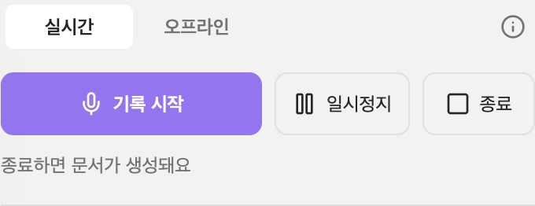
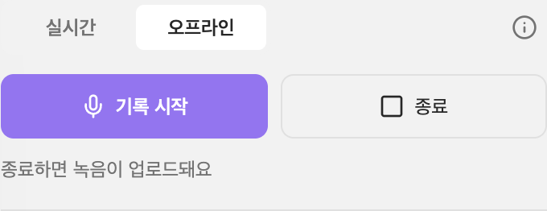

# Tiro for Obsidian

Bring your [Tiro](https://tiro.ooo) meeting notes into your vault. Sync summaries and transcripts as Markdown, search your notes, insert links to them, and control recordings in the Tiro desktop app.

**Requirements:** a Tiro account. Available features depend on your Tiro plan, and the plugin reads your notes from Tiro's servers (see [Privacy and network use](#privacy-and-network-use)).

## Preview





## Setup

1. Install the plugin and enable it under **Settings → Community plugins**.
2. Open the plugin options and select **Sign in** under **Tiro account**. Your browser opens the Tiro sign-in page; when you approve, it returns to Obsidian.
3. Optional: instead of signing in, create an API key at <https://tiro.ooo/platform/me/api-keys> and paste it into **API key (optional)**. A key takes priority over the sign-in.

### Desktop and mobile

Signing in works on the desktop app only. The plugin listens on `127.0.0.1` (ports 27193 to 27196) for the browser's one-time redirect, which mobile apps can't do. On mobile, use an API key or sign in on a desktop.

The sign-in tokens are stored in this plugin's data file (`data.json`), like the API key. If you sync your vault's `.obsidian` folder between devices, the sign-in goes with it, so a phone can use a sign-in made on a desktop. If you don't want that, don't sync the plugin's data, or sign out when you're done.

## Recording controls

On desktop, choose Live or Offline in the side panel. Start a new recording, pause a live note, finish a live note to create its document, or end and upload an offline recording. These actions require Tiro desktop 4.12.1 or later and use the desktop app’s signed-in account. Sending a request does not confirm completion. Search and sync remain available without the desktop app.

## Commands

| Command | What it does |
| --- | --- |
| **Open panel** | Opens the Tiro side panel with the sync status and your recent notes. Also available from the ribbon. |
| **Toggle panel** | Opens or closes the side panel. |
| **Sync notes** | Saves your recent Tiro notes as Markdown files. Also available from the side panel. |
| **Search notes** | Searches Tiro (empty search shows recent notes). Picking a result saves or refreshes that note and opens it. |
| **Insert note link** | Inserts `[Title](tiro-web-link)` at the cursor. |

No hotkeys are set by default. Assign your own under **Settings → Hotkeys**.

## What a synced note looks like

```markdown
---
tiro_guid: note-abc123
title: Weekly Team Meeting
created: 2026-03-05T10:30:00Z
updated: 2026-03-05T11:45:00Z
source_type: live-voice
duration: 1:00:05
participants:
  - Alice Kim
tiro_url: https://tiro.ooo/n/abc123
---
%% tiro:start %%
## Summary
…
## Transcript
…
%% tiro:end %%
```

- The plugin only rewrites the text between `%% tiro:start %%` and `%% tiro:end %%` and the `tiro_*` fields it owns. Anything you write outside that block is kept when the note syncs again.
- Notes are matched by `tiro_guid`, so you can rename or move the files freely.
- A note is skipped when its `updated` value matches Tiro. Picking a note from **Search notes** always refreshes it.
- The transcript is added only when **Include transcript** is on. Locked paragraphs are skipped.
- A sync looks at your 100 most recent notes.

## Options

- **Tiro account**: sign in or out. Shows the signed-in account when Tiro provides one.
- **API key (optional)**: a Tiro key used instead of the sign-in. It is stored in this vault's plugin data and sent only to Tiro.
- **Sync folder**: where notes are saved. Default `Tiro`.
- **Include transcript**: off by default.
- **File name format**: default `YYYY-MM-DD title`. Characters that files can't contain are replaced.
- **Sync on startup**: off by default.
- **Auto sync interval**: minutes between automatic syncs; `0` turns it off.

The interface is available in English, Korean and Japanese and follows the app language.

## Privacy and network use

- The plugin talks to Tiro (`https://api.tiro.ooo` for sign-in and `https://mcp.tiro.ooo` to read your notes) with your sign-in token or API key. It does not send vault content anywhere.
- During sign-in the plugin starts a short-lived web server on `127.0.0.1` that accepts one request from your browser and then stops. It is not reachable from other computers. Sign-in asks only for read access to your notes and summaries.
- There is no telemetry.

## Manual installation

Copy `main.js`, `manifest.json` and `styles.css` from a release into `<your vault>/.obsidian/plugins/tiro/`, then enable the plugin.

## Development

```bash
npm install
npm run dev     # watch build
npm run build   # type check and production build
npm test        # unit tests
npm run lint
```

## License

MIT

## Desktop recording

Requires Tiro desktop 4.12.1 or later, installed and signed in. Recording commands use the desktop app's account independently of this integration's API login. The live end-and-create-document handler shipped in 4.12.1; older apps may ignore it. There is no fallback to legacy start-recording or stop-recording.

| Action | Desktop URL |
| --- | --- |
| Start Live Note | `tiro://notes/create/live-voice?background=true` |
| Start Offline Recording | `tiro://notes/create/offline-mode?background=true` |
| Pause Live Note | `tiro://notes/pause/live-voice?background=true` |
| End Live Note and Create Document | `tiro://notes/end/live-voice?background=true` |
| End and Upload Offline Recording | `tiro://notes/end/offline-mode?background=true` |

Pause affects only the current live recording. It leaves the note open and does not request a summary. End Live Note finishes the current live note and creates its document. End and upload affects only the current offline session, including a paused session. Pause and both end actions target the recording session even when another note is displayed. No `guid` or `target` is sent.

A request being sent does not confirm recording, pause, document generation, or upload completion. Check the Tiro app. Recording status files and the menu-bar indicator remain excluded while PR #4417 is under review. The older generic Stop Recording command is replaced by three explicit commands (live pause, live end, offline end and upload); update any old hotkey assignments.
