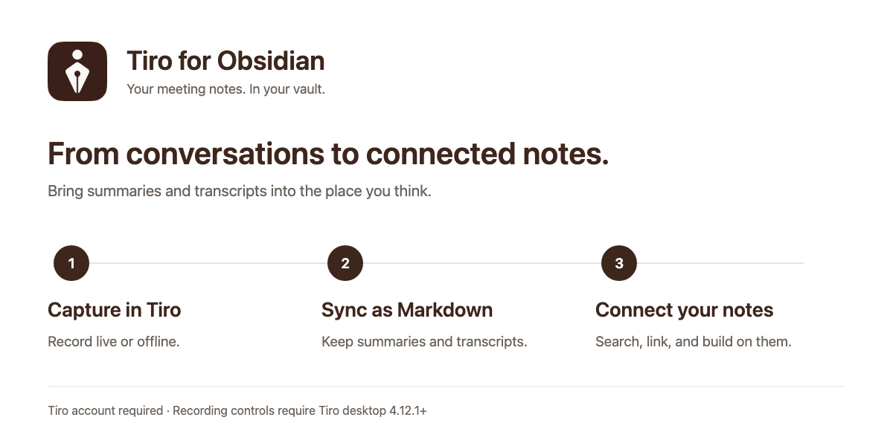

[English](https://github.com/plato-corp/tiro-obsidian#readme) · [한국어](https://github.com/plato-corp/tiro-obsidian/blob/main/docs/README.ko.md) · [日本語](https://github.com/plato-corp/tiro-obsidian/blob/main/docs/README.ja.md)

# 会議の記録を、自分のノートにつなげる
[Tiro](https://tiro.ooo)の会議要約と文字起こしをMarkdownとしてObsidianに保存できます。過去の会話を見つけ、自分のノートと並べて、その先の考えを書き足しましょう。

## できること
- **会議ノートを同期:** 指定したフォルダーに要約を保存し、必要に応じて文字起こしも取り込みます。
- **検索してつなげる:** サイドパネルからTiroのノートを検索して保管庫で開いたり、編集中のノートにリンクを挿入したりできます。
- **自分の文章を残す:** 再同期で更新するのはTiroの管理領域です。その外に書いた内容は保持され、同期済みファイルの移動や名前変更も可能です。
- **デスクトップ録音をリクエスト:** Tiroでライブ・オフライン録音を開始し、ライブ記録の終了と文書作成、またはオフライン録音の終了とアップロードをリクエストできます。

上の図は機能の流れを示すもので、実際のアプリのスクリーンショットではありません。

## はじめに
1. コミュニティプラグインから **Tiro** をインストールし、有効にします。
2. デスクトップでは設定の **Sign in** からログインします。モバイルではTiroのAPIキーを入力してください。
3. 同期先フォルダーを選びます。既定値は `Tiro` です。会話の全文も取り込む場合は **Include transcript** をオンにします。
4. Tiroのサイドパネルで **Sync now** を選ぶか、**Search notes** で特定のノートを取り込みます。

APIキーは [TiroのAPIキー設定](https://tiro.ooo/platform/me/api-keys) で作成できます。デスクトップでもログインの代わりに使えます。プラグインの表示言語はObsidianの設定に従い、英語・韓国語・日本語に対応しています。

## ご利用前に
**Tiroアカウントとインターネット接続が必要です。** 利用できる機能や使用量の上限はTiroのプランによって異なります。プラグインは無料で、Tiroサービスの料金プランは別です。

検索と同期はデスクトップ・モバイルで利用できます。録音操作には、ログイン済みの **Tiroデスクトップアプリ4.12.1以降** が必要です。ボタンはアプリにリクエストを送るため、録音・文書作成・アップロードの完了はTiroで確認してください。アプリとプラグインのログインアカウントが異なる場合があります。

## プライバシーと認証情報
- プラグインはTiroからノートを読み取ります。**保管庫の内容はアップロードせず**、テレメトリーも含みません。
- ログインには `https://api.tiro.ooo`、ノートの取得には `https://mcp.tiro.ooo` を使います。デスクトップのログイン時のみ `127.0.0.1` でコールバックを受け付け、他のコンピューターからはアクセスできません。
- APIキーとOAuthトークンは、**プラグインの実行中のみメモリーに保持**します。`data.json` への保存や端末間の同期は行いません。アプリ再起動・プラグイン再読み込み後はログインまたはキーの再入力が必要です。
- 更新時には旧バージョンが保存した認証情報を現在の設定ファイルから削除します。既存のバックアップやバージョン履歴は削除しません。

## 同期の仕組み
直近100件を確認し、`tiro_guid` でノートを識別します。ファイルを移動・改名しても同じノートとして扱います。管理ブロックと所有するメタデータを更新し、ブロック外の文章は保持します。変更のないノートはスキップし、**Search notes** で選択したノートは再取得します。文字起こしは任意で、ロックされた段落は取得しません。

## ヘルプ
設定・コマンド・手動インストール・管理ブロックの形式・開発については [詳細ガイド（英語）](reference.md) をご覧ください。不具合や機能のご要望は [GitHub Issues](https://github.com/plato-corp/tiro-obsidian/issues) にお寄せください。OS、Obsidian・プラグインのバージョン、再現手順を記載し、認証情報や非公開の会議内容は含めないでください。

制作: [The Plato](https://tiro.ooo) · [MITライセンス](../LICENSE)
