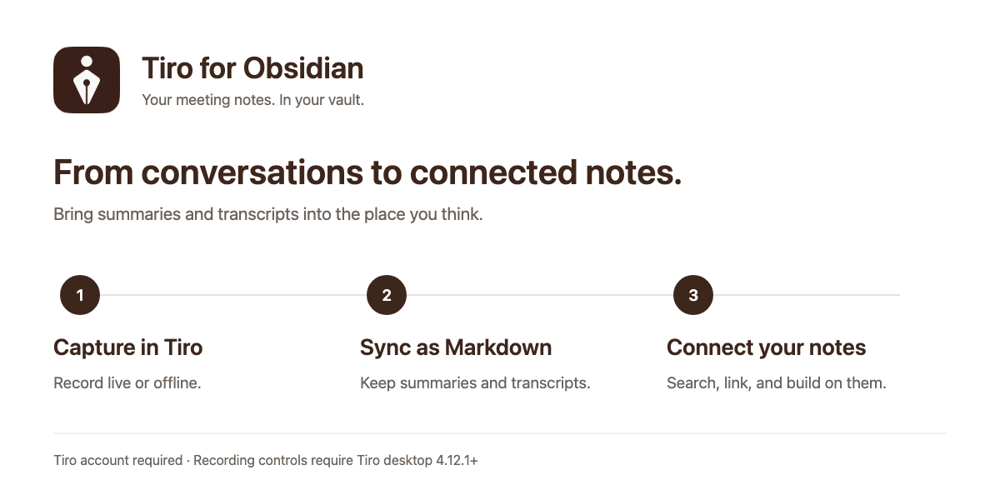

[English](https://github.com/plato-corp/tiro-obsidian#readme) · [한국어](https://github.com/plato-corp/tiro-obsidian/blob/main/docs/README.ko.md) · [日本語](https://github.com/plato-corp/tiro-obsidian/blob/main/docs/README.ja.md)

# 회의 노트를 내 지식과 연결하세요
[Tiro](https://tiro.ooo)의 회의 요약과 전사를 Markdown으로 가져와 옵시디언에 보관합니다. 지난 대화를 찾고, 내 노트 옆에 저장하고, 그 위에 생각을 이어 적으세요.

## 할 수 있는 일
- **회의 노트 동기화:** 원하는 폴더에 요약을 저장하고, 필요하면 전사도 함께 가져옵니다.
- **검색과 연결:** 사이드 패널에서 티로 노트를 검색해 보관함에 열거나, 작성 중인 노트에 링크를 넣습니다.
- **내가 쓴 내용 보존:** 다시 동기화해도 티로가 관리하는 영역 밖의 글은 유지됩니다. 동기화한 파일을 옮기거나 이름을 바꿔도 됩니다.
- **데스크톱 녹음 요청:** 티로의 실시간·오프라인 녹음을 시작하고, 실시간 기록 종료 후 문서를 만들거나 오프라인 녹음을 종료해 업로드하도록 요청합니다.

위 그림은 기능 흐름을 설명한 것으로 실제 앱 화면 캡처가 아닙니다.

## 시작하기
1. 커뮤니티 플러그인에서 **Tiro**를 설치하고 활성화합니다.
2. 플러그인 설정에서 데스크톱은 **로그인**을 선택합니다. 모바일에서는 티로 API 키를 입력합니다.
3. 동기화 폴더를 선택합니다. 기본값은 `Tiro`이며, 대화 전문도 가져오려면 **전사 포함**을 켭니다.
4. 티로 사이드 패널에서 **지금 동기화**를 누르거나, **노트 검색**으로 특정 노트를 가져옵니다.

API 키는 [티로 API 키 설정](https://tiro.ooo/platform/me/api-keys)에서 만들 수 있으며 데스크톱에서도 로그인 대신 사용할 수 있습니다. 플러그인 화면은 옵시디언의 언어 설정에 따라 한국어·영어·일본어로 표시됩니다.

## 사용 전 확인
**티로 계정과 인터넷 연결이 필요합니다.** 이용 가능한 기능과 사용량은 티로 요금제에 따라 달라집니다. 플러그인은 무료이며 티로 서비스 요금제는 별도입니다.

검색과 동기화는 데스크톱·모바일에서 사용할 수 있습니다. 녹음 제어는 **티로 데스크톱 앱 4.12.1 이상**을 설치하고 로그인해야 합니다. 버튼은 앱에 요청을 보내므로 녹음·문서 생성·업로드 완료 여부는 티로에서 확인하세요. 데스크톱 앱과 플러그인이 로그인한 계정은 다를 수 있습니다.

## 개인정보와 로그인 정보
- 플러그인은 티로에서 노트를 읽습니다. **보관함의 내용을 업로드하지 않으며**, 텔레메트리를 포함하지 않습니다.
- 로그인에는 `https://api.tiro.ooo`, 노트 조회에는 `https://mcp.tiro.ooo`를 사용합니다. 데스크톱 로그인 중에는 `127.0.0.1`에 짧게 콜백 수신기를 열며 다른 컴퓨터에서는 접근할 수 없습니다.
- API 키와 OAuth 토큰은 **플러그인이 실행 중인 동안 메모리에만** 보관합니다. `data.json`에 저장하거나 다른 기기로 동기화하지 않습니다. 앱을 재시작하거나 플러그인을 다시 불러오면 로그인하거나 키를 다시 입력해야 합니다.
- 업그레이드 시 구버전이 저장한 인증정보는 현재 설정 파일에서 제거합니다. 이미 만들어진 백업이나 버전 기록까지 삭제하지는 않습니다.

## 동기화 방식
최근 노트 100개를 확인하며 `tiro_guid`로 연결하므로 파일 이동이나 이름 변경 후에도 같은 노트로 인식합니다. 플러그인이 관리하는 블록과 메타데이터를 갱신하고, 블록 밖에 직접 쓴 내용은 보존합니다. 변경되지 않은 노트는 건너뛰며 **노트 검색**에서 선택하면 해당 노트를 새로 가져옵니다. 전사 포함은 선택 사항이고 잠긴 문단은 가져오지 않습니다.

## 도움말
설정·명령·수동 설치·관리 블록 형식·개발 안내는 [상세 문서(영어)](reference.md)를 참고하세요. 문제나 기능 요청은 [GitHub Issues](https://github.com/plato-corp/tiro-obsidian/issues)에 남겨 주세요. OS, 옵시디언·플러그인 버전과 재현 순서를 적고 인증정보나 비공개 회의 내용은 포함하지 마세요.

제작: [The Plato](https://tiro.ooo) · [MIT 라이선스](../LICENSE)
